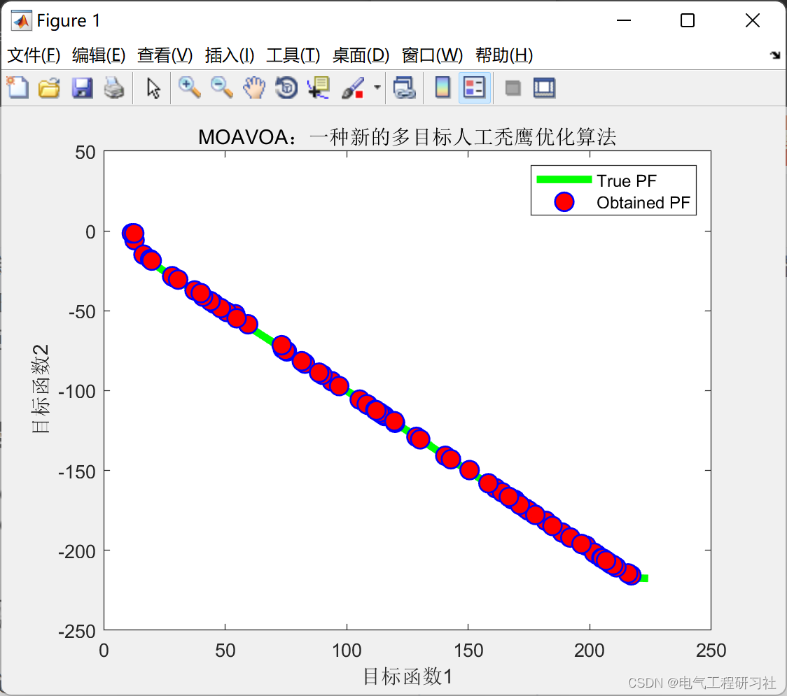
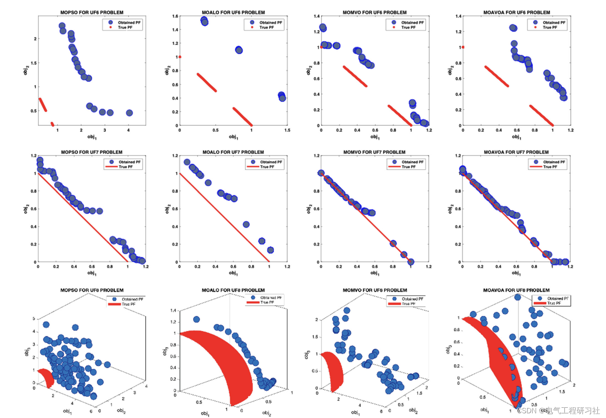

# Optimization Algorithm | MOAVOA: A New Multi-Objective Artificial Hawk Optimization Algorithm (Matlab Code)

1. Overview
Over the past few decades, metaheuristic optimization has attracted much attention from researchers in both research and problem-solving optimization [1]. These techniques are mathematically introduced and accessible to everyone, leading to faster progress in this field. Metaheuristics aim to optimize solutions. Generally, there are single-objective and multi-objective strategies in metaheuristic optimization.
In [1], a hybrid method combining genetic algorithms and Particle Swarm Optimization (PSO) was proposed to solve Multi-Objective Optimization Problems (MOO). In this combined algorithm, local search operations are used in the low-density areas of the external archive to enhance and advance non-dominated solutions. Additionally, a new version of MOO problems using global penalty ranking for PSO was presented in [27]. This allows for addressing data situations in the search space and transparent distance regions within the rope. In [30], a Multi-Objective Vortex Search Algorithm (MOVS) was proposed, which uses crowding distance methods and the first non-dominated sorting technique. Crossover operations can be performed using mobile algorithms to increase convergence capability, solution Pareto front proximity, and the inverse incomplete gamma function, thereby successfully advancing Pareto solutions. In [31], a Non-Dominated Immune Algorithm was proposed for MMO problems, thus detaching itself from non-dominated neighbor selection, elitism, heuristic search operators, and immune operator motivations. In [32], the Ant Colony Optimization (ACO) for MOO was proposed as MOACO, utilizing concepts such as pheromone module, design process, solution estimation, and update. In [33], a Multi-Objective Artificial Algae Algorithm (MOAAA) was proposed to indicate inspiration from microalgae. The algorithm employs a non-dominated rope distance method. From functional indicators, the convergence capability of MOAAA is superior to other algorithms.
The Artificial Vulture Optimization Algorithm (AVOA) is a multi-objective algorithm developed for solving the Multi-Objective AVOA (MOAVOA) optimization problem. The inspiring concept of AVOA is based on the lifestyle of African vultures. Archive, grid, and leader selection mechanisms are used to develop MOAVOA. The proposed MOAVOA algorithm was tested on 8 real-world engineering design problems and 17 unconstrained and constrained mathematical optimization problems to study its applicability in estimating Pareto optimal solutions. Multi-objective Particle Swarm Optimization, Multi-objective Ant Lion Optimization, Multi-objective Multi-universe Optimization, Multi-objective Genetic Algorithm, Multi-objective Salp Swarm Algorithm, and Multi-objective Grey Wolf Optimizer were compared with MOAVOA using generational distance as a performance metric, including maximum propagation and gap performance indicators. This paper demonstrates that MOAVOA can outperform other methods. The conclusion is that the proposed MOAVOA has advantages in solving challenging multi-objective problems.
Mathematical Model
As previously summarized: Intelligent Optimization Algorithms - Harvest Hawk Algorithm (Matlab implementation)
For detailed articles, refer to Part 4.
Run Results
Edit
Edit
Matlab Code and Detailed Articles Reading
This article only showcases part of the code, with all the code and detailed articles available here:

## Images

<!-- PAYMENT_BLOCK -->

## Get this dataset

- Payment link (Stripe): [Buy now](https://buy.stripe.com/3cs8yP7sY87d0vu9AB)
- Payment QR code: 

<!-- /PAYMENT_BLOCK -->
